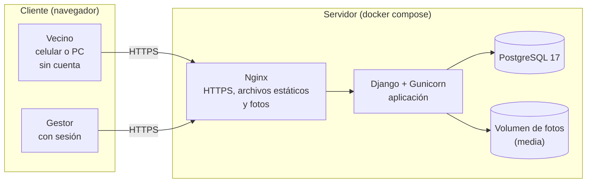
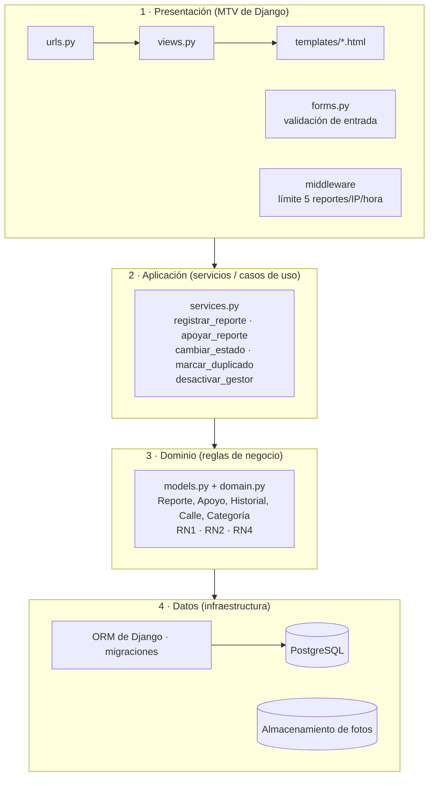

# Decisión de arquitectura · Mi Barrio Reporta

**Proyecto:** Mi Barrio Reporta · Barrio Cuendina, Amaguaña
**Asignatura:** Construcción y Evolución de Software · NRC 36848 · Grupo 6
**Integrantes:** Mateo Criollo, David Cepeda
**Fecha:** 11/11/2026 · **Estado:** Propuesta para el sprint 3 (diseño, semanas 5–6)
**Entradas:** RF-01 a RF-17, RNF1 a RNF8, RN1 a RN5 (Tarea 2) y CU01 a CU13 (Tarea 3)

---

## 1. Decisión en una frase

Mi Barrio Reporta se construirá como una **aplicación web cliente-servidor**, organizada internamente en **cuatro capas** (presentación, aplicación, dominio y datos) y con la capa de presentación implementada con el patrón **MVC en su variante MTV de Django** (Modelo–Plantilla–Vista). Todo se entrega como **un solo sistema desplegable** (monolito modular) con Docker Compose.

Las tres arquitecturas que el equipo tenía en mente no compiten entre sí. Cada una responde a una pregunta distinta, y el proyecto usa las tres:

| Pregunta | Arquitectura | Qué decide |
|---|---|---|
| ¿Dónde se ejecuta cada parte? | **Cliente-servidor** | El navegador del vecino o del gestor pide; el servidor procesa y guarda. |
| ¿Cómo se ordena el código dentro del servidor? | **Por capas** | Qué responsabilidad tiene cada parte y quién puede llamar a quién. |
| ¿Cómo se arma cada pantalla? | **MVC (MTV en Django)** | Cómo se separan los datos, la página que se muestra y la lógica que las une. |

---

## 2. Qué condiciona la decisión

### 2.1 Complejidad del proyecto

| Factor | Valor en el proyecto | Consecuencia para la arquitectura |
|---|---|---|
| Funcionalidad | 17 RF, 11 casos de uso de v1 (CU01–CU11), 2 actores | Complejidad **baja-media**: un CRUD con flujo de estados, no un sistema distribuido. |
| Reglas de negocio | RN1–RN5 (publicación, prioridad, un apoyo por dispositivo, transiciones de estado, último gestor) | Son pocas pero críticas: necesitan **un lugar único y probado**, no estar repartidas en pantallas. |
| Usuarios | Un barrio; RNF1 pide < 2 s con **20 usuarios simultáneos** | No hace falta escalar componentes por separado. Un servidor basta con holgura. |
| Equipo | 2 personas, 10 h/semana cada una, ~29 h de historias por sprint | Cada hora en infraestructura sale de las historias. La arquitectura debe ser **barata de operar**. |
| Tecnología ya fijada | Django 5.2, PostgreSQL 17, Docker Compose, GitHub Actions (sprint 1) | La arquitectura debe **aprovechar** lo que Django ya resuelve (ORM, formularios, autenticación, admin, PBKDF2). |
| Calidad exigida | RNF7: cobertura ≥ 70 % y CI en cada PR | Las reglas deben poder probarse **sin navegador ni HTTP**. |

### 2.2 Alcance (qué entra y qué no)

- **v1.0 y v1.1:** reportes sin cuenta, foto, reportes parecidos, apoyos y prioridad, consulta por código, listado público, moderación, historial, duplicados, catálogos y gestores.
- **Fuera del alcance (acta):** app móvil nativa, notificaciones (CU12), mapas (CU13), varios barrios, integración municipal, exportación, IA.
- **Implicación:** la arquitectura no tiene que resolver hoy la app móvil ni las notificaciones, pero **no debe impedir** agregarlas en una v2 sin reescribir el sistema (ver sección 6).

---

## 3. Alternativas evaluadas

| # | Alternativa | Descripción breve |
|---|---|---|
| A | **Cliente-servidor + capas + MVC/MTV (monolito modular)** | Un proyecto Django que genera las páginas en el servidor; la lógica de negocio vive en una capa de servicios y dominio separada de las vistas. |
| B | Cliente-servidor con SPA + API REST | Frontend en React/Vue consumiendo una API Django REST Framework. Dos proyectos, dos despliegues. |
| C | MVC "clásico" de Django sin capas adicionales | Toda la lógica en vistas y formularios (vistas gordas). Lo más rápido al inicio. |
| D | Microservicios | Servicios separados (reportes, catálogos, gestores) con su propia base de datos y comunicación por red. |
| E | Arquitectura hexagonal / limpia estricta | Dominio aislado de Django con puertos, adaptadores y repositorios propios. |

### 3.1 Matriz de decisión ponderada (1 = malo, 5 = excelente)

| Criterio | Peso | A | B | C | D | E |
|---|---:|:-:|:-:|:-:|:-:|:-:|
| Ajuste al alcance y complejidad | 25 % | 5 | 3 | 5 | 1 | 3 |
| Viabilidad para 2 personas, 10 h/sem | 20 % | 5 | 2 | 5 | 1 | 2 |
| Mantenibilidad y pruebas (RNF7) | 15 % | 4 | 4 | 2 | 3 | 5 |
| Seguridad (RNF3, RNF4) | 15 % | 5 | 3 | 3 | 2 | 4 |
| Costo de despliegue y operación (RNF8, R6) | 15 % | 5 | 3 | 5 | 1 | 5 |
| Capacidad de crecer a v2 | 10 % | 3 | 4 | 3 | 5 | 3 |
| **Puntaje total** | | **4,65** | 3,05 | 4,05 | 1,85 | 3,55 |

### 3.2 Por qué se descartan las demás

- **B · SPA + API REST.** Duplica el trabajo: dos proyectos, dos pipelines, autenticación por tokens, CORS y validaciones repetidas en el cliente y el servidor. Para formularios y listados que Django genera de forma nativa, esto consumiría una parte importante de las ~29 h por sprint. Además agrega superficie de ataque al formulario anónimo (R1). Su ventaja, servir a una app móvil, está fuera del alcance.
- **C · MVC sin capas.** Es la más rápida al inicio, pero RN4 (transiciones) se necesita en CU05 y CU06, y RN2 (prioridad) en CU03 y CU07. Con vistas gordas esas reglas se copiarían en varias vistas y una corrección en una no llegaría a las otras. Probarlas exigiría simular peticiones HTTP, lo que pone en riesgo RNF7.
- **D · Microservicios.** Resuelve problemas que el proyecto no tiene (equipos grandes, escalado independiente, miles de usuarios) y crea otros que sí afectarían: transacciones entre servicios (marcar duplicado modifica dos reportes y suma un apoyo), varias bases de datos que respaldar (RNF6) y un despliegue que difícilmente cumpliría RNF8 (< 15 min).
- **E · Hexagonal estricta.** Es la mejor para pruebas, pero obliga a reescribir lo que Django ya da (ORM, formularios, autenticación) detrás de interfaces propias. Para cinco reglas de negocio, el costo no se compensa. La alternativa A conserva su idea principal (reglas aisladas y probables) con mucho menos código.

---

## 4. Arquitectura elegida

### 4.1 Vista física: cliente-servidor



- El **cliente** es solo el navegador: no se instala nada (cumple la exclusión de app nativa y RNF5).
- El **servidor** concentra datos y reglas. Ningún dato sensible (contacto del vecino, RF-17) sale del servidor hacia una vista pública (RNF3).
- Los tres contenedores (Nginx, Django, PostgreSQL) se levantan con `docker compose up` (RNF8).

### 4.2 Vista lógica: capas dentro del servidor



**Regla de dependencia:** cada capa solo llama a la de abajo. Una vista nunca cambia el estado de un reporte directamente: llama a `services.cambiar_estado(...)`, y ese servicio consulta al dominio si la transición es válida.

| Capa | Responsabilidad | Componentes Django | No debe hacer |
|---|---|---|---|
| **Presentación** | Recibir la petición, validar el formato, mostrar la página | `urls.py`, `views.py`, `forms.py`, `templates/`, middleware | Decidir reglas de negocio ni escribir en la base directamente |
| **Aplicación** | Orquestar cada caso de uso en una transacción | `services.py` por app | Generar HTML ni leer `request` |
| **Dominio** | Expresar las reglas del barrio | `models.py`, `domain.py` (funciones puras) | Saber de HTTP, sesiones o plantillas |
| **Datos** | Guardar y recuperar información | ORM, migraciones, PostgreSQL, almacenamiento de fotos | Contener reglas de negocio |

### 4.3 Dónde vive cada regla y requisito clave

| Regla / requisito | Capa | Cómo se implementa |
|---|---|---|
| **RN1** solo lo aprobado es público | Dominio + Datos | Un manager `Reporte.publicos` que filtra los estados Aprobado, Derivado, En proceso y Resuelto. Las vistas públicas solo usan ese manager. |
| **RN2** prioridad por apoyos | Dominio | Función pura `calcular_prioridad(apoyos)`; la invocan `apoyar_reporte` y `marcar_duplicado`. |
| **RN3** un apoyo por dispositivo | Aplicación + Datos | El servicio verifica la huella del dispositivo y la base lo garantiza con una restricción única `(reporte, huella)`. |
| **RN4** transiciones de estado | Dominio | Tabla `TRANSICIONES` y método `Reporte.puede_cambiar_a(estado)`; CU05 y CU06 usan el mismo servicio. |
| **RN5** siempre un gestor activo | Aplicación | `desactivar_gestor` cuenta los activos dentro de una transacción con bloqueo (`select_for_update`). |
| **RF-11** historial de cambios | Aplicación | `cambiar_estado` crea el registro de historial en la misma transacción que el cambio. |
| **RNF3** ocultar contacto | Presentación | Las plantillas públicas no reciben el contacto; una prueba automatizada recorre las vistas públicas y lo verifica. |
| **RNF4** límite por IP y EXIF | Presentación + Aplicación | Middleware de límite de envíos; el servicio limpia los metadatos EXIF con Pillow antes de guardar la foto. |

### 4.4 Organización del repositorio

```
mibarrioreporta/
├── config/                 # settings, urls raíz, wsgi
├── reportes/               # CU01–CU07, CU11
│   ├── domain.py           # RN2, RN4 (funciones puras, sin Django)
│   ├── models.py           # Reporte, Apoyo, HistorialEstado; manager publicos (RN1)
│   ├── services.py         # casos de uso (capa de aplicación)
│   ├── forms.py
│   ├── views.py            # públicas y de gestor separadas
│   ├── templates/reportes/
│   └── tests/              # test_domain, test_services, test_views
├── catalogos/              # CU08: calles y categorías
├── gestores/               # CU09, CU10: cuentas y sesión (auth de Django)
├── templates/base.html     # diseño responsivo común (RNF5)
├── docker-compose.yml      # nginx + web + db
└── .github/workflows/ci.yml
```

Cada **app de Django** corresponde a un módulo del negocio (reportes, catálogos, gestores) y dentro de cada una se respetan las cuatro capas. Por eso se describe como *monolito modular*: un solo despliegue, pero con fronteras internas claras que ambos integrantes pueden trabajar en paralelo sin pisarse.

### 4.5 Ejemplo de recorrido: CU06 Actualizar avance del reporte

1. **Presentación:** el gestor envía el formulario. `views.actualizar_avance` comprueba la sesión (CU10) y valida que el comentario no esté vacío con `CambioEstadoForm`.
2. **Aplicación:** la vista llama a `services.cambiar_estado(reporte_id, nuevo_estado, gestor, comentario)`, que abre una transacción.
3. **Dominio:** el servicio pregunta a `reporte.puede_cambiar_a(nuevo_estado)`. Si la transición no está en RN4, lanza `TransicionInvalida` (flujo 6a de CU06).
4. **Datos:** se guarda el nuevo estado y el registro de historial (RF-11) en la misma transacción.
5. **Presentación:** la vista redirige con un mensaje de éxito o muestra el error del dominio.

---

## 5. Justificación

### 5.1 Para el equipo de desarrollo

1. **Se ajusta al tamaño real del problema.** Un barrio, 20 usuarios simultáneos y 11 casos de uso no justifican infraestructura distribuida. Las horas se van a historias, no a configurar servicios.
2. **Aprovecha Django en lugar de luchar contra él.** Django ya es MTV y trae autenticación, PBKDF2 (RNF3), protección CSRF, formularios y panel de administración. La capa de servicios es la única pieza que se agrega.
3. **Las reglas se escriben y prueban una sola vez.** RN2 y RN4 son funciones puras que se prueban en milisegundos sin base de datos ni HTTP. Esto facilita la cobertura ≥ 70 % (RNF7) y una CI rápida.
4. **Trabajo en paralelo con menos conflictos.** Un integrante puede hacer plantillas y vistas mientras el otro escribe servicios y pruebas, acordando solo la firma de la función de servicio.
5. **Despliegue simple y reproducible.** Tres contenedores, una base de datos y un respaldo (RNF6). Cumple RNF8 y reduce el riesgo R6 (hosting): cabe en un VPS pequeño o un plan gratuito/estudiantil.
6. **Seguridad por defecto.** Al generar el HTML en el servidor, el contacto del vecino nunca viaja al navegador en las vistas públicas, y no hay una API pública expuesta que proteger.

### 5.2 Para el usuario final (vecinos y directiva)

Explicación pensada para presentarla a la directiva del barrio sin términos técnicos:

> **¿Cómo funciona por dentro?** Piense en una oficina de atención del barrio.
>
> - **Cliente-servidor:** usted (el vecino) llega a la ventanilla con su celular o computadora y entrega su reporte. Detrás de la ventanilla está la oficina (el servidor) que guarda los papeles y los procesa. Usted **no tiene que instalar nada**: basta con abrir la página en el navegador.
> - **Capas:** dentro de la oficina, cada persona tiene una tarea. El de la ventanilla recibe y revisa que el formulario esté completo. El encargado aplica las reglas del barrio (por ejemplo, "un reporte solo se publica cuando la directiva lo aprueba"). El archivista guarda todo en el archivador. Como cada uno hace solo lo suyo, **si cambia una regla, se corrige en un solo lugar** y no se rompe lo demás.
> - **MVC:** cada pantalla separa *la información* (los reportes), *cómo se ve* (la página) y *quién decide qué mostrar*. Por eso se puede mejorar el diseño de la página sin tocar los datos.

**Lo que esto significa para ustedes:**

| Beneficio | Por qué ocurre con esta arquitectura |
|---|---|
| Se usa desde cualquier celular o computadora, sin descargar una aplicación | Es una página web (cliente-servidor) que se adapta a la pantalla (RNF5). |
| Sus datos de contacto están protegidos | El nombre y el teléfono solo se procesan en el servidor y nunca se muestran en las páginas públicas (RNF3). |
| Nadie puede publicar algo sin revisión | La regla de aprobación está en una capa central que todas las pantallas deben respetar (RN1). |
| Es rápido | Un solo servidor responde las consultas en menos de 2 segundos (RNF1). |
| Es barato de mantener | Es un solo sistema en un solo servidor: un solo lugar que actualizar y respaldar cada semana (RNF6). |
| La directiva puede ajustar el sistema sin programadores | Calles, categorías y gestores se administran desde la propia aplicación (CU08, CU09). |
| Puede crecer después | Si el barrio pide más adelante avisos por correo o un mapa, se agregan sobre lo construido, sin empezar de cero. |

---

## 6. Consecuencias y riesgos

**Positivas**
- Reglas de negocio centralizadas y probadas de forma aislada.
- Un único despliegue, un único respaldo y una única base de datos.
- Curva de aprendizaje baja: el equipo ya trabaja con Django.

**Negativas y cómo se mitigan**

| Riesgo | Mitigación |
|---|---|
| El monolito se despliega completo aunque cambie una sola pantalla | Con el volumen del proyecto el despliegue tarda minutos; la CI evita subir cambios rotos. |
| Tentación de saltarse la capa de servicios y escribir lógica en las vistas | Regla en la plantilla de PR: "¿la vista modifica modelos directamente?"; revisión cruzada obligatoria. |
| Un único servidor es un punto único de falla | Aceptable para un barrio; respaldo semanal y restauración probada en < 1 h (RNF6). |

**Camino de evolución a v2 (sin reescribir)**
- **CU12 Notificaciones:** se agregan desde la capa de servicios (`cambiar_estado` emite un evento o una tarea en cola). Las vistas no cambian.
- **CU13 Mapas:** se agregan latitud y longitud al modelo y un componente de mapa en la plantilla; las reglas no cambian.
- **App móvil o integración municipal:** se agrega una API con Django REST Framework como **otra capa de presentación** que llama a los mismos servicios. Esta es la principal ganancia de separar la capa de aplicación desde el inicio.

---

## 7. Criterios para verificar la arquitectura

La decisión se considera bien aplicada si al cierre del sprint 4 se cumple:

- [ ] Ninguna vista llama a `.save()` sobre `Reporte` ni crea `HistorialEstado`; todo pasa por `services.py` (revisión en PR).
- [ ] `domain.py` no importa nada de `django.http`, `request` ni plantillas.
- [ ] Las pruebas de RN2 y RN4 corren sin base de datos y cubren todas las transiciones de la tabla RN4.
- [ ] Una prueba recorre todas las URL públicas y confirma que no aparece el contacto del vecino (RNF3).
- [ ] `docker compose up` levanta Nginx, Django y PostgreSQL en una máquina limpia en menos de 15 min (RNF8).
- [ ] La cobertura reportada por coverage.py en la CI es ≥ 70 % (RNF7).
