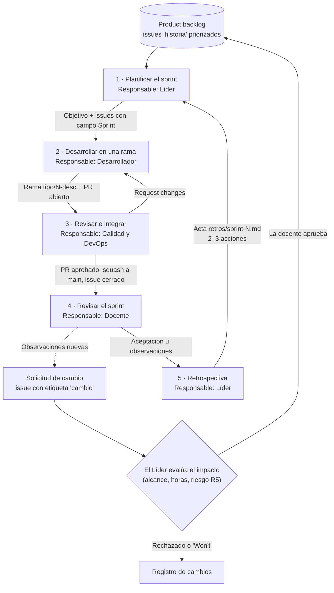
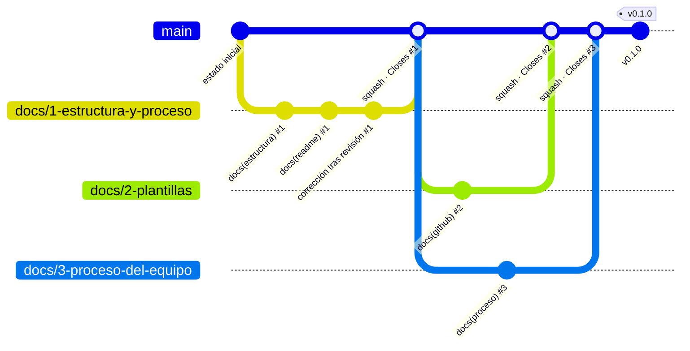

# Proceso del equipo · Mi Barrio Reporta

**Asignatura:** Construcción y Evolución de Software · NRC 36848 · Grupo 6
**Integrantes:** Mateo Criollo, David Cepeda · **Docente (product owner y cliente):** Ing. Nancy Betancourt
**Versión:** 1.0 · semana 5 (sprint 3) · Cualquier cambio a este documento entra por un PR revisado.

Este documento contiene las partes A (metodología), B (roles), C (artefactos) y E (ramas y convenciones) del laboratorio «El proceso del equipo». La forma de trabajar en el día a día se resume en [CONTRIBUTING.md](../../CONTRIBUTING.md).

---

## A. Metodología y flujo del proceso

### A.1 Metodología elegida

En la matriz de decisión del Taller 1 ([docs/01-inicio](../01-inicio/Criollo_Cepeda_Taller1_CONSTEVO.pdf)) se eligió un **modelo incremental**: 66 puntos, frente a 61 de ágil y 58 de cascada. Es una propuesta híbrida: primero una planificación inicial y después **ocho iteraciones de dos semanas**.

Este modelo encaja con el proyecto por cuatro razones. El alcance y las exclusiones (sin app móvil, sin mapas, sin notificaciones) y los hitos del curso son fijos, así que se planifican al inicio. Las reglas del barrio (RN2 y RN4) todavía se validan con la directiva (dudas D2 y D3, riesgo R11), así que conviene entregar algo revisable cada dos semanas. El curso exige documentación formal en cada fase. Y con 2 integrantes a 10 h/semana, el proceso tiene que ser liviano: cuatro eventos cortos y toda la evidencia en GitHub.

### A.2 Proceso de un sprint

*Figura 1. Proceso de un sprint de Mi Barrio Reporta.*

*Tabla 1. Actividades del sprint.*

| Actividad | Entrada | Salida | Responsable |
|---|---|---|---|
| Planificar el sprint | Backlog priorizado (Prioridad y Talla), capacidad de unas 29 h, acciones de la retro anterior y registro de riesgos | Objetivo del sprint e issues con el campo Sprint asignado | Líder |
| Desarrollar en ramas | Issue en «Por hacer» con criterios de aceptación | Rama `tipo/N-descripcion`, commits y PR con `Closes #N` | Desarrollador |
| Revisar e integrar | PR abierto (y CI en verde si incluye código) | PR aprobado y fusionado con squash; issue en «Hecho» | Calidad y DevOps |
| Revisar el sprint | Incremento en `main` | Aceptación u observaciones de la docente (y de la directiva cuando participa) | Docente |
| Retrospectiva | Tablero, PR del sprint y registro de riesgos | `docs/proceso/retros/sprint-N.md` con 2 o 3 acciones | Líder |
| Gestionar un cambio de alcance | Issue con la etiqueta `cambio` | Cambio aceptado en el backlog o anotado en el registro de cambios | Líder (evalúa) · Docente (aprueba) |

### A.3 Eventos

*Tabla 2. Eventos del proceso (plan de construcción del Taller 1).*

| Evento | Cuándo | Duración | Participantes | Evidencia en GitHub |
|---|---|---|---|---|
| Planificación del sprint | Primer día de cada sprint (cada 2 semanas desde el lunes 12/10/2026) | 1 h | Mateo, David | Objetivo en la descripción del Project; issues con el campo Sprint |
| Seguimiento | Martes y jueves | 15 min | Mateo, David | Tablero actualizado; etiqueta `bloqueado` en los issues detenidos |
| Revisión del sprint | Último día del sprint | 30 min | Equipo, docente y directiva (cuando participa) | Incremento en `main`; aceptación u observaciones comentadas en el issue del sprint |
| Retrospectiva | Después de la revisión | 30 min | Mateo, David | `docs/proceso/retros/sprint-N.md` fusionado por PR; registro de riesgos revisado |

### A.4 Relación con los hitos del curso

*Tabla 3. Sprints e hitos.*

| Sprint | Semanas | Objetivo | Hito o entregable |
|---|---|---|---|
| 1 | 1–2 | Acordar el proyecto y preparar el entorno | Tarea 1, Taller 1 y Taller 2 |
| 2 | 3–4 | Elicitar y especificar requisitos | Tarea 2 |
| 3 | 5–6 | Diseñar y validar el prototipo | Tarea 3, arquitectura, este laboratorio · **v0.1.0** |
| 4 | 7–8 | Administración y registro de reportes | HU-08, HU-13, HU-14, HU-01, HU-03 |
| 5 | 9–10 | Consulta, moderación y listado público | HU-04, HU-10, HU-11, HU-07 |
| 6 | 11–12 | v1.0, fotos y apoyos | **v1.0.0** (semana 11); HU-02, HU-06, HU-05 |
| 7 | 13–14 | Bandeja, duplicados, pruebas y piloto | HU-09, HU-12; pruebas OWASP y SUS |
| 8 | 15–16 | Cerrar y entregar | **v1.1.0**, manuales e informe de cierre |

---

## B. Roles y responsabilidades

### B.1 Roles

El equipo tiene 2 integrantes. Por eso, en cada sprint una persona es **Líder y también Calidad y DevOps**, y la otra es **Analista**. Los roles se alternan cada sprint y los dos son siempre desarrolladores.

**Regla de revisión:** el revisor de un PR es siempre el integrante que no es el autor. Si el autor es quien tiene el rol de Calidad, revisa y aprueba el Analista.

*Tabla 4. Roles.*

| Rol | Responsabilidades concretas |
|---|---|
| Docente (product owner y cliente) | Prioriza y aprueba el backlog, aprueba los cambios de alcance y acepta el incremento. |
| Líder | Facilita la planificación, el seguimiento y la retrospectiva; mantiene el tablero y el objetivo del sprint; evalúa las solicitudes de cambio; gestiona el registro de riesgos. |
| Analista | Redacta los issues de historia con criterios Dado/Cuando/Entonces; mantiene la trazabilidad RF ↔ HU ↔ CU; actualiza `docs/02-requisitos` y `docs/03-modelado`. |
| Calidad y DevOps | Revisa y fusiona los PR; vela por la definición de terminado; mantiene la CI, Docker Compose y la protección de `main`; crea las etiquetas de versión. |
| Desarrollador (ambos) | Toma issues, trabaja en ramas, escribe pruebas y abre PR siguiendo las convenciones. |

### B.2 Matriz RACI

R: lo hace · A: aprueba o rinde cuentas (una sola por fila) · C: consultado · I: informado.

*Tabla 5. Matriz RACI.*

| Actividad | Docente | Líder | Analista | Calidad y DevOps | Desarrollador |
|---|:-:|:-:|:-:|:-:|:-:|
| Priorizar el backlog | A | C | R | I | I |
| Redactar issues y criterios de aceptación | C | I | A/R | C | C |
| Planificar el sprint | I | A/R | C | C | C |
| Desarrollar en una rama y abrir el PR | I | I | I | C | A/R |
| Revisar un pull request | – | I | C | A | R* |
| Fusionar en `main` | I | I | I | A/R | C |
| Mantener el tablero al día | I | A/R | C | C | R |
| Evaluar una solicitud de cambio | A | R | C | C | I |
| Facilitar la retrospectiva | I | A/R | C | C | C |
| Aceptar el incremento | A/R | C | I | C | I |
| Publicar una versión (etiqueta) | I | C | I | A/R | I |

\* Lo revisa el desarrollador que no es el autor del PR.

### B.3 Plan de rotación

*Tabla 6. Rotación de roles.*

| Sprint | Semanas | Líder | Analista | Calidad y DevOps |
|---|---|---|---|---|
| 1 | 1–2 | Mateo Criollo | David Cepeda | Mateo Criollo |
| 2 | 3–4 | David Cepeda | Mateo Criollo | David Cepeda |
| 3 | 5–6 | Mateo Criollo | David Cepeda | Mateo Criollo |
| 4 | 7–8 | David Cepeda | Mateo Criollo | David Cepeda |
| 5 | 9–10 | Mateo Criollo | David Cepeda | Mateo Criollo |
| 6 | 11–12 | David Cepeda | Mateo Criollo | David Cepeda |
| 7 | 13–14 | Mateo Criollo | David Cepeda | Mateo Criollo |
| 8 | 15–16 | David Cepeda | Mateo Criollo | David Cepeda |

---

## C. Artefactos del proceso

### C.1 Catálogo

*Tabla 7. Catálogo de artefactos.*

| Artefacto | Propósito | Formato o plantilla | Ubicación | Responsable | Actualización |
|---|---|---|---|---|---|
| Product backlog | HU-01 a HU-16 priorizadas | Issue con `.github/ISSUE_TEMPLATE/historia.md` | Issues con la etiqueta `historia` + vista Backlog del Project | Analista | Al crear o cambiar una historia |
| Sprint backlog | Lo que se hará en el sprint | Campo Sprint (iteración de 2 semanas) | GitHub Project | Equipo | En cada planificación |
| Incremento | Lo terminado al cierre del sprint | Código y documentos en `main`; etiqueta SemVer | Rama `main`, etiquetas `v0.1.0`, `v1.0.0`, `v1.1.0` | Calidad y DevOps | Con cada PR fusionado y en cada hito |
| Documentos de inicio | Concepto, acta, matriz de decisión, riesgos y plan de construcción | PDF (Tarea 1, Taller 1, Taller 2) | `docs/01-inicio/` | Líder | Cuando cambia el alcance o el plan |
| Requisitos e historias | RF, RNF, RN, HU, backlog y plan de sprints | DOCX/PDF (Tarea 2) | `docs/02-requisitos/` | Analista | Cuando se aprueba un cambio |
| Casos de uso | CU01–CU13 y diagrama | DOCX/PDF + diagrama editable | `docs/03-modelado/` | Analista | Cuando cambian los RF |
| Decisión de arquitectura | Arquitectura propuesta y alternativas | PDF (borrador del 11/11/2026) | `docs/04-arquitectura/` | Calidad y DevOps | Cuando cambia una decisión |
| Definición de terminado | Condiciones para cerrar un issue | Lista numerada | `CONTRIBUTING.md`, plantilla de PR y este documento | Calidad y DevOps | En la retro, si el equipo la cambia |
| Proceso del equipo | Metodología, roles, artefactos y ramas | Markdown | `docs/proceso/PROCESO.md` | Líder | Cuando una retro cambia una regla |
| Registro de riesgos | Riesgos R1–R12 y respuestas | Tabla del Taller 1 + Tabla 18 de la Tarea 2 | `docs/01-inicio/` y `docs/02-requisitos/` | Líder | En cada planificación y retrospectiva |
| Actas de retrospectiva | Qué funcionó, qué no y acciones | Markdown | `docs/proceso/retros/sprint-N.md` | Líder | Al cierre de cada sprint |
| Registro de cambios | Cambios a documentos ya aprobados | Tabla (como la sección C.4) | Este documento y `docs/02-requisitos/` | Líder | Con cada cambio aprobado |

### C.2 Definición de terminado

La definición de terminado es la misma en este documento, en `CONTRIBUTING.md` y en la plantilla de PR. Amplía la del Taller 1, que tenía 4 condiciones (ver C.4).

*Tabla 8. Definición de terminado.*

| N.º | Condición |
|---|---|
| 1 | Cumple todos sus criterios de aceptación (Dado/Cuando/Entonces) y se demostró en la revisión del sprint. |
| 2 | La rama y los commits siguen las convenciones de CONTRIBUTING.md (tipo/N-descripcion y tipo(ámbito): descripción (#N)). |
| 3 | El PR tiene Closes #N, al menos un comentario de revisión y la aprobación del otro integrante, y todas las conversaciones resueltas. |
| 4 | Si incluye código: tiene pruebas automatizadas de su lógica, la cobertura total se mantiene en al menos el 70 % y la integración continua está en verde. |
| 5 | La documentación afectada (README, docs/, manuales) está actualizada en el mismo PR. |
| 6 | Se fusionó con Squash and merge, el issue quedó en Hecho y, si incluye código, el cambio quedó desplegado en el entorno de pruebas. |

### C.3 Regla de cambio de los documentos

Los documentos de `docs/` solo se modifican mediante un PR revisado. Si el cambio afecta el alcance aprobado, primero se abre un issue con la etiqueta `cambio`, el Líder evalúa el impacto y la docente lo aprueba.

### C.4 Cambios a los acuerdos del Taller 1

*Tabla 9. Registro de cambios del proceso.*

| N.º | Acuerdo del Taller 1 | Cambio | Motivo |
|---|---|---|---|
| 1 | Ramas `tipo/descripcion-corta` | Se agrega el número de issue: `tipo/N-descripcion-corta` | Vincular cada rama con su issue (laboratorio, parte E) |
| 2 | Commits `tipo(ámbito): descripción` | Se agrega `(#N)` al final y el tipo `ci` | Trazabilidad commit ↔ issue |
| 3 | Definición de terminado de 4 condiciones | Pasa a 6 condiciones; las de código se aplican cuando el PR incluye código | Mínimo de 5 del laboratorio; los PR de solo documentación no tienen pruebas |
| 4 | Fusión de PR sin método definido | *Squash and merge* y borrado automático de la rama | Un commit limpio por PR en `main` |

---

## E. Flujo de ramas y convenciones

### E.1 Comparación de estrategias

*Tabla 10. Comparación de estrategias de ramas.*

| Criterio | Git Flow | GitHub Flow | Trunk-based |
|---|---|---|---|
| Tamaño del equipo | Pensado para equipos grandes con varias versiones en paralelo; con 2 personas sobra | Adecuado para 2–10 personas | Exige mucha disciplina y una CI madura que todavía no existe |
| Frecuencia de entrega | Entregas planificadas con ramas `release/` | Continua; cada PR deja `main` lista | Varias integraciones al día |
| Manejo de versiones | Ramas `release/` y `hotfix/` | Etiquetas SemVer sobre `main` | Etiquetas o *feature flags* |
| Riesgo de conflictos | Alto: ramas largas (`develop`) | Bajo: ramas cortas por issue | Muy bajo, pero los errores llegan directo al tronco |
| Decisión | Descartado | **Elegido** | Descartado |

### E.2 Decisión

Se elige **GitHub Flow con una rama por issue**. Con 2 integrantes, entregas cada 2 semanas y una sola versión en producción, Git Flow agregaría ramas `develop` y `release` que nadie necesita mantener. Trunk-based supone una CI confiable desde el primer día, y el proyecto todavía no tiene código. GitHub Flow cumple la regla de `main` protegida con 1 aprobación, mantiene cada cambio vinculado a un issue y permite marcar los hitos con etiquetas sobre `main`.

### E.3 Convenciones

*Tabla 11. Convenciones.*

| Elemento | Convención | Ejemplos |
|---|---|---|
| Rama | `tipo/N-descripcion-corta`, en minúsculas, con guiones y sin tildes. Tipos: `feature`, `fix`, `docs`, `test`, `chore`, `ci` | `docs/1-estructura-y-proceso` · `feature/20-reportar-sin-cuenta` · `fix/35-validacion-foto` |
| Commit | `tipo(ámbito): descripción en infinitivo (#N)`. Tipos: `feat`, `fix`, `docs`, `test`, `refactor`, `chore`, `ci` | `docs(proceso): agregar matriz RACI (#3)` · `feat(reportes): generar código de seguimiento (#22)` |
| Pull request | Título con el formato de un commit sin `(#N)`; cuerpo con la plantilla y `Closes #N` | `docs(proceso): agregar PROCESO.md` · `Closes #3` |
| Fusión | *Squash and merge* y borrado automático de la rama | Un commit limpio por PR en `main` |
| Versión | Etiqueta anotada SemVer sobre `main` | `v0.1.0` (sem. 6) · `v1.0.0` (sem. 11) · `v1.1.0` (sem. 16) |

### E.4 Diagrama del flujo

*Figura 2. Flujo de ramas de Mi Barrio Reporta.*
